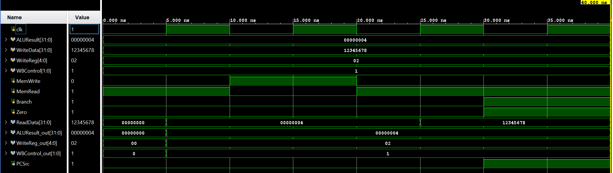

# Memory and Writeback Stages (MIPS Pipeline)

#### Design Scope and Assumptions
*   **In scope:** Implementation of the Instruction Memory (MEM) and Writeback (WB) stages of a MIPS pipeline. This includes the Data Memory array, Branch AND gate, MEM/WB pipeline latch, and the Writeback multiplexer.
*   **Out of scope:** The Instruction Fetch (IF), Instruction Decode (ID), and Execute (EX) stages are intentionally excluded from this module.
*   **Assumptions:** The design utilizes a 32-bit architecture for data and addresses. The Data Memory contains 256 words (32-bit) of memory and is initialized using a `data.txt` file. The MEM/WB latch relies on a positive clock edge for synchronous data transfer.
*   **Limitations:** Because the Writeback stage consists solely of a 2-to-1 multiplexer, the verification and testbench focus primarily on the Memory stage's functionality.

#### Requirements
| Requirement | Description | Verification Method |
| ------ | ------ | ------ |
| REQ-01 | The Data Memory shall read from or write to the specified address based on the `memread` and `memwrite` control signals. | Testbench simulation using `memoryTB.v`. |
| REQ-02 | The branch logic shall assert `PCSrc` by logically ANDing the `branch` (membranch) and `zero` signals. | Testbench simulation using `memoryTB.v`. |
| REQ-03 | The MEM/WB latch shall capture and output the read data, ALU result, destination register, and WB control bits on the rising clock edge. | Inspection and top-level stage simulation. |
| REQ-04 | The Writeback Mux shall select between the Data Memory output and the ALU result using the `sel` signal to feed data back to the Decode stage. | Component simulation or inspection. |

#### Architecture
##### Timing or Behavioral Summary



#### Implementation
##### Source Code
| File | Description |
| ------ | ------ |
| [`MEMORY.v`](https://github.com/ET-struct/Memory-and-Writeback/blob/main/MEMORY.v) | Top-level Memory stage module that connects the data memory, branch AND gate, and the MEM/WB latch. |
| [`data_memory.v`](https://github.com/ET-struct/Memory-and-Writeback/blob/main/data_memory.v) | 32-bit Data Memory array containing 256 words, handling load and store operations. |
| [`mem_wb.v`](https://github.com/ET-struct/Memory-and-Writeback/blob/main/mem_wb.v) | Pipeline latch boundary storing state between the Memory and Writeback stages, initializing internal registers to 0. |
| [`wb_mux.v`](https://github.com/ET-struct/Memory-and-Writeback/blob/main/wb_mux.v) | 32-bit 2-to-1 multiplexer to select the final writeback data using a `sel` input. |
| [`AND.v`](https://github.com/ET-struct/Memory-and-Writeback/blob/main/AND.v) | Combinational logic gate used to evaluate branch conditions. |
| [`memoryTB.v`](https://github.com/ET-struct/Memory-and-Writeback/blob/main/memoryTB.v) | Verification testbench driving clock, ALU results, and memory control signals. |
| [`data.txt`](https://github.com/ET-struct/Memory-and-Writeback/blob/main/data.txt) | Initial binary values loaded into the first 6 addresses of the Data Memory array. |

##### Implementation Notes
*   **Branch Target Calculation:** The `PCSrc` signal, which tells the Fetch stage whether to branch, is calculated in this stage using a simple AND gate (`AND.v`) taking `membranch` and `zero` as inputs. 
*   **Memory Initialization:** The `data_memory.v` module uses `$readmemb("data.txt", DMEM)` to load initial values into the first few memory addresses upon startup, which is critical for verifying load instructions.
*   **Latch Initialization:** The `mem_wb` latch uses an `initial` block to set all outputs to `0` at time zero to prevent undefined `X` states from propagating during the first few simulation cycles.

#### Verification
##### Verification Strategy
The design is verified using **behavioral simulation** via the `memoryTB.v` testbench.
Verification covers:
*   A Memory Read operation (`MemRead = 1`, `MemWrite = 0`) retrieving data from address `0x00000004`.
*   A Memory Write operation (`MemWrite = 1`) storing `0x12345678` into memory, followed by a subsequent read to verify data persistence.
*   Branch condition validation by asserting `Branch = 1` and `Zero = 1` to check the `PCSrc` output.

##### Testbench and Waveform
Save screenshots and waveform images in the repository's images/ folder.


The primary integrated testbench source is available [*here*](https://github.com/ET-struct/Memory-and-Writeback/blob/main/memoryTB.v).

##### Results
| Test Case | Expected Result | Observed Result | Status |
| ------ | ------ | ------ | ------ |
| TC-01 — Mem Read | `data_memory` outputs the initialized contents from `data.txt` to `ReadData`. | Initialized contents from `data.txt` are outputted. | Pass |
| TC-02 — Mem Write | `WriteData` (0x12345678) is successfully stored and readable on the next cycle. | 0x12345678 is readable. | Pass |
| TC-03 — Branch Evaluation | `PCSrc` goes high when `Branch` and `Zero` are both asserted. | PCSrc goes high when specified. | Pass |

#### Reproduction Instructions
##### Tools and Versions
*   **Simulator / synthesis tool:** Xilinx Vivado or Icarus Verilog (due to `` `timescale 1ns / 1ps`` usage).
*   **Language / standard:** Verilog.
*   **Operating system:** Windows
*   **Additional dependencies:** `data.txt` must be present in the simulation directory.

##### Build and Run
```bash
# To compile using Icarus Verilog:
iverilog -o mem_sim MEMORY.v data_memory.v mem_wb.v wb_mux.v AND.v memoryTB.v

# To execute the compiled simulation:
vvp mem_sim
```
##### Expected Output
```plaintext
# Expected testbench monitor output (from data_memory.v initialization):
	DMEM[0] = 0000_0000_0000_0000_0000_0000_0000_0000
	DMEM[1] = 0000_0000_0000_0000_0000_0000_0000_0001
```
##### Repository Organization
```plaintext
.
├── README.md
├── images/
│   └── memoryTB_simulation.png
├── AND.v
├── MEMORY.v
├── data.txt
├── data_memory.v
├── mem_wb.v
├── memoryTB.V
└── wb_mux
```
